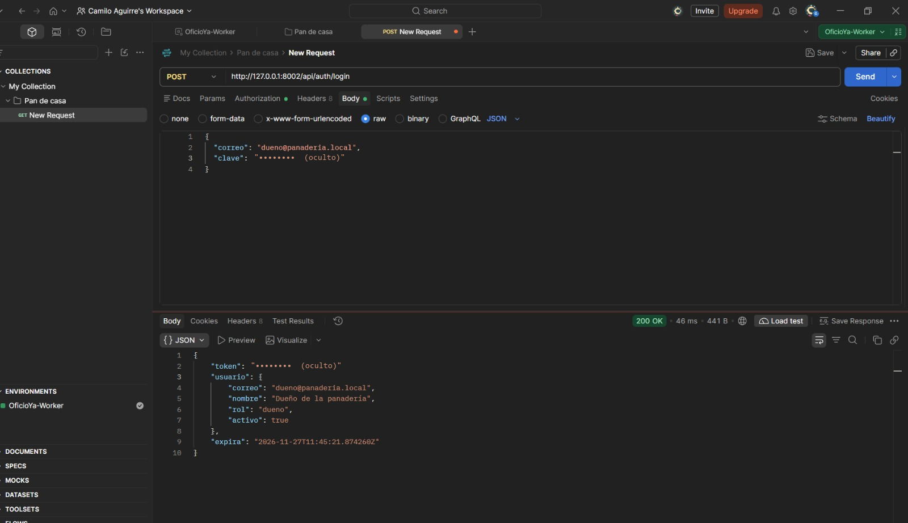
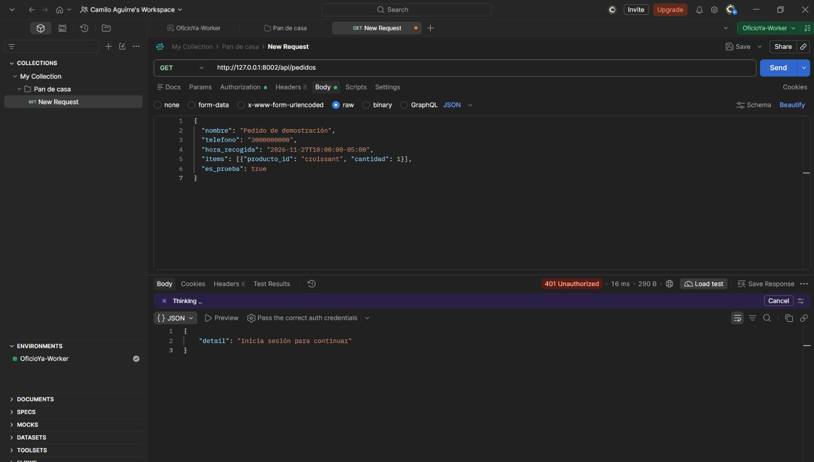
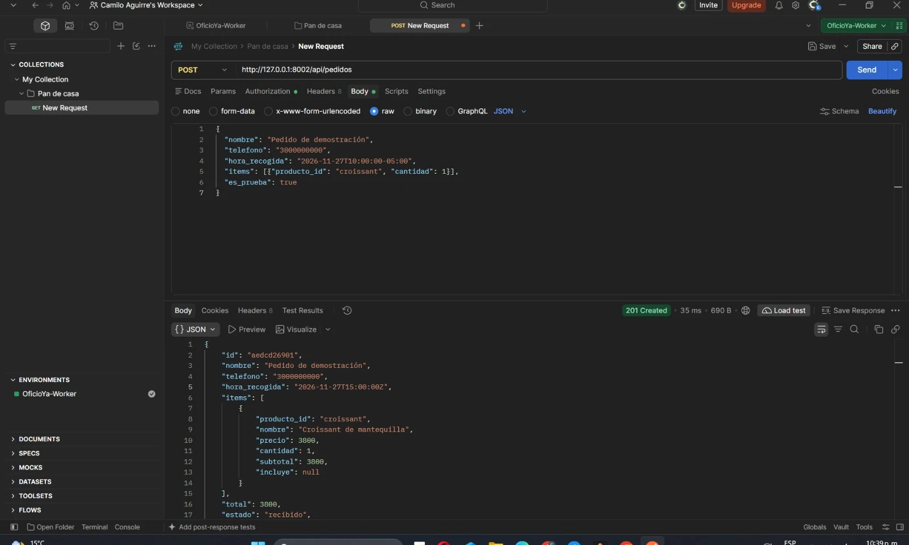
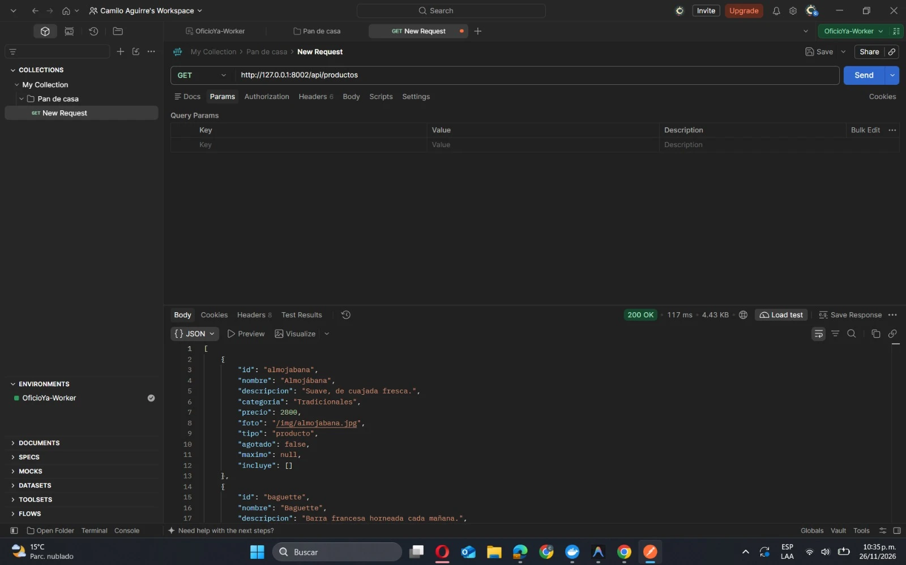

# Pruebas de la API con Postman

Estas pruebas se hicieron con Postman contra la API corriendo en el equipo, en `http://127.0.0.1:8002`. Cubren el inicio de sesión del personal, la protección del panel, el registro de un pedido y la consulta del catálogo. Las mismas rutas existen en el ambiente dev de Azure.

En la primera captura se taparon la contraseña y el token de sesión, porque el repositorio es público.

## 1. Inicio de sesión del dueño

`POST /api/auth/login`

Se envía el correo y la contraseña del dueño en el cuerpo de la solicitud. La API verifica la contraseña contra su hash scrypt y responde `200 OK` con un token de sesión, los datos del usuario con su rol (`dueno`) y la fecha en que vence la sesión, 8 horas después. Ese token es el que el panel manda en el encabezado `Authorization: Bearer` en las siguientes solicitudes.

## 2. Consultar los pedidos sin sesión

`GET /api/pedidos`

La lista de pedidos es una ruta del personal. Si la solicitud llega sin un token de sesión válido, la API responde `401 Unauthorized` con el mensaje "Inicia sesión para continuar" y no muestra ningún pedido. Así se comprueba que los datos de los clientes no quedan expuestos.

## 3. Registrar un pedido

`POST /api/pedidos`

Se registra un pedido de un croissant con nombre, teléfono y hora de recogida, marcado con `es_prueba: true` para que no aparezca en la lista normal del panel. La API responde `201 Created` con el número del pedido, el estado `recibido` y el total. El precio no lo manda el cliente, la API lo toma del catálogo (3.800 pesos). La hora de recogida llega en hora de Colombia (10:00, UTC-5) y se guarda en UTC (15:00).

## 4. Consultar el catálogo

`GET /api/productos`

Es una ruta pública, no necesita sesión. Responde `200 OK` con los productos disponibles en la tienda. Cada uno trae su identificador, nombre, descripción, categoría, precio, foto, tipo (producto o combo), si está agotado, el máximo que se puede pedir según las unidades del día y, en los combos, los productos que incluye.

## Resumen

| Prueba | Ruta | Sesión | Resultado esperado | Resultado |
| --- | --- | --- | --- | --- |
| Inicio de sesión | `POST /api/auth/login` | No | `200` con token y rol | `200 OK` |
| Pedidos sin sesión | `GET /api/pedidos` | No | `401` | `401 Unauthorized` |
| Registrar un pedido | `POST /api/pedidos` | No | `201` con total calculado por la API | `201 Created` |
| Catálogo | `GET /api/productos` | No | `200` con los productos | `200 OK` |
