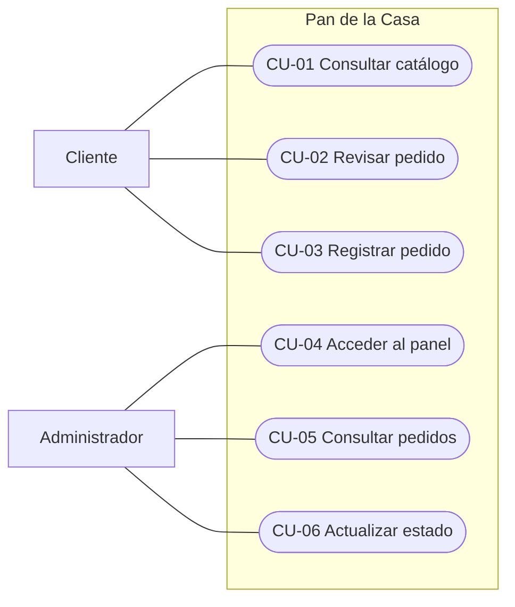

# Requerimientos y casos de uso de Pan de la Casa

El MVP permite consultar el catálogo de la panadería, registrar pedidos para recoger y gestionar su estado desde el panel de administración. La tienda y el panel se describen según el alcance previsto. Su validación en navegador queda pendiente hasta integrar el frontend.

## 1. Lista general de requerimientos

### 1.1 Requerimientos funcionales

| ID | Nombre | Descripción |
| --- | --- | --- |
| RF-01 | Consultar el catálogo | La tienda debe mostrar los productos disponibles con nombre, descripción, categoría, precio e imagen. |
| RF-02 | Revisar el pedido | El cliente debe poder seleccionar productos, ajustar cantidades y revisar el resumen antes de enviar el pedido. |
| RF-03 | Registrar un pedido para recoger | El sistema debe recibir el nombre, el teléfono y la hora de recogida, validar el pedido, calcular el total con los precios del catálogo y devolver un identificador de confirmación. |
| RF-04 | Acceder al panel de administración | El administrador debe poder ingresar su clave para consultar y actualizar pedidos. El panel debe informar si la clave fue rechazada. |
| RF-05 | Consultar los pedidos | El sistema debe mostrar al administrador autorizado los pedidos recientes, del más nuevo al más antiguo, con sus productos, hora de recogida y estado. Los pedidos marcados como prueba se excluyen de la consulta predeterminada. |
| RF-06 | Actualizar el estado de un pedido | El administrador debe poder cambiar el estado de un pedido a `recibido`, `listo`, `entregado` o `cancelado` y consultar el estado guardado. |

### 1.2 Requerimientos no funcionales

| ID | Categoría | Requerimiento verificable |
| --- | --- | --- |
| RNF-01 | Seguridad | La API debe exigir la clave administrativa mediante `X-Admin-Key` al listar pedidos o modificar su estado. Debe responder con HTTP `401` si la clave falta o es incorrecta. La clave real se configura fuera del control de versiones. |
| RNF-02 | Usabilidad | El catálogo, la revisión y la confirmación deben poder usarse en escritorio y en móvil. Los mensajes de validación deben indicar el dato o la condición que impide registrar el pedido. |
| RNF-03 | Persistencia | Los pedidos deben seguir disponibles al reiniciar MongoDB mientras se conserve el volumen de datos. |
| RNF-04 | Despliegue local | La API y MongoDB deben poder iniciarse con `docker compose up --build` usando la configuración local documentada. |
| RNF-05 | Observabilidad | El servicio debe exponer `/healthz` para comprobar el proceso y `/readyz` para comprobar la conexión a MongoDB. El registro de las solicitudes de negocio debe incluir método, ruta, código HTTP y duración. |
| RNF-06 | Verificación | El proyecto debe incluir pruebas automatizadas del catálogo, la creación de pedidos y las operaciones administrativas. La suite completa debe pasar antes de fusionar el MVP a `develop`. |

## 2. Casos de uso

### 2.1 CU-01 · Consultar el catálogo

| Campo | Descripción |
| --- | --- |
| **Requerimiento asociado** | RF-01 |
| **Actor** | Cliente |
| **Precondiciones** | La tienda y el servicio de catálogo están disponibles. |
| **Flujo principal** | 1. El cliente abre la tienda. 2. El sistema consulta los productos disponibles y los ordena por nombre. 3. La tienda muestra la información de cada producto. |
| **Flujo alternativo** | Si el catálogo está vacío, la tienda indica que no hay productos disponibles. |
| **Poscondiciones** | El cliente puede seleccionar productos del catálogo. |

### 2.2 CU-02 · Revisar el pedido

| Campo | Descripción |
| --- | --- |
| **Requerimiento asociado** | RF-02 |
| **Actor** | Cliente |
| **Precondiciones** | El cliente abrió el catálogo y seleccionó al menos un producto. |
| **Flujo principal** | 1. El cliente abre el resumen. 2. La tienda muestra los productos, las cantidades y el total estimado. 3. El cliente ajusta las cantidades si es necesario y continúa al registro. |
| **Flujo alternativo** | Si elimina todos los productos, el cliente debe volver al catálogo y seleccionar al menos uno para continuar. |
| **Poscondiciones** | La selección queda lista para confirmar. |

### 2.3 CU-03 · Registrar un pedido para recoger

| Campo | Descripción |
| --- | --- |
| **Requerimiento asociado** | RF-03 |
| **Actor** | Cliente |
| **Precondiciones** | El cliente revisó un pedido con al menos un producto. |
| **Flujo principal** | 1. El cliente ingresa nombre, teléfono y hora de recogida. 2. Confirma el pedido. 3. El sistema valida los datos, el horario y la disponibilidad de los productos. 4. El servidor calcula el total con los precios del catálogo y guarda el pedido en estado `recibido`. 5. La tienda muestra el identificador del pedido y el total confirmado. |
| **Flujo alternativo** | Si los datos son inválidos, la hora no cumple las reglas o un producto dejó de estar disponible, el sistema rechaza el registro e indica el motivo. El cliente puede corregir el pedido y volver a enviarlo. |
| **Reglas de negocio** | La recogida se programa en hora de Colombia, entre las 06:00 y las 20:00, con al menos 30 minutos de preparación y hasta siete días de anticipación. |
| **Poscondiciones** | El pedido queda registrado y disponible para consulta administrativa. |

### 2.4 CU-04 · Acceder al panel

| Campo | Descripción |
| --- | --- |
| **Requerimiento asociado** | RF-04 |
| **Actor** | Administrador |
| **Precondiciones** | El panel está disponible y el administrador conoce la clave configurada. |
| **Flujo principal** | 1. El administrador abre el panel e ingresa la clave. 2. El panel envía una solicitud de consulta con el encabezado `X-Admin-Key`. 3. La API verifica la clave y autoriza la consulta. 4. El panel presenta el listado. |
| **Flujo alternativo** | Si la API devuelve HTTP `401`, el panel indica que la clave fue rechazada y permite volver a ingresarla. |
| **Poscondiciones** | El administrador puede usar el panel con la clave válida. La API verifica la clave en cada solicitud administrativa. |

### 2.5 CU-05 · Consultar los pedidos

| Campo | Descripción |
| --- | --- |
| **Requerimiento asociado** | RF-05 |
| **Actor** | Administrador |
| **Precondiciones** | El panel dispone de una clave administrativa válida y MongoDB está disponible. |
| **Flujo principal** | 1. El administrador abre o actualiza la lista. 2. El panel solicita los pedidos recientes con la clave. 3. La API devuelve los pedidos en orden descendente de creación, excluyendo los registros de prueba por defecto. 4. El panel muestra los productos, la hora de recogida y el estado de cada pedido. |
| **Flujo alternativo** | Si no hay pedidos para mostrar, el panel presenta una lista vacía con el mensaje correspondiente. |
| **Poscondiciones** | El administrador puede revisar los pedidos y seleccionar uno para actualizarlo. |

### 2.6 CU-06 · Actualizar el estado de un pedido

| Campo | Descripción |
| --- | --- |
| **Requerimiento asociado** | RF-06 |
| **Actor** | Administrador |
| **Precondiciones** | El administrador tiene una clave válida y puede seleccionar un pedido del listado. |
| **Flujo principal** | 1. El administrador selecciona un pedido y el nuevo estado. 2. El panel envía el identificador, el estado y la clave a la API. 3. La API valida el estado y guarda el cambio. 4. El panel muestra el estado que devuelve la API. |
| **Flujo alternativo** | Si el pedido ya no existe, la API devuelve HTTP `404`. Si el estado es inválido, devuelve HTTP `422`. El panel informa el error y conserva el estado anterior. |
| **Poscondiciones** | El nuevo estado queda guardado y aparece en las próximas consultas. |

### 2.7 Diagrama general de casos de uso

